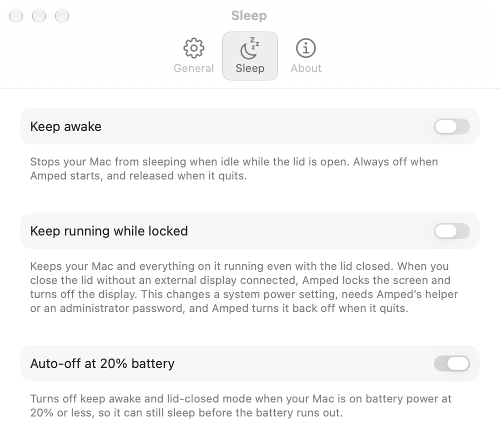

<div align="center">


# Amped

**Close the lid. Your agents keep working.**

Keeps your Mac awake with the lid closed, and locked while it is.

[Download](https://github.com/gustaferiksson/amped/releases/latest) · [Install with Homebrew](#install) · Requires macOS 26

</div>

<p align="center">
  <picture>
    <source media="(prefers-color-scheme: dark)" srcset="docs/images/settings-sleep-dark.png">
    
  </picture>
</p>

## What it does

Start Claude Code, Codex or a long build, close the lid and put the Mac in your bag. Amped keeps it running and locks the screen, so the work carries on behind your password. No external display, no dummy HDMI plug.

Amped is a small, native menu bar app in the spirit of Amphetamine. It uses `pmset disablesleep`, the only switch that overrides clamshell sleep, because `caffeinate` alone stops working the moment the lid shuts.

### Why not a dummy HDMI plug?

A dummy plug tricks macOS into thinking an external display is connected, so the Mac stays awake with the lid closed. It also stays **unlocked**, with a running session in your bag. Amped needs no hardware, locks the screen and turns off the display when the lid closes, and lets the Mac sleep again if the battery drops to 20%.

If you do keep a dummy plug or a real display connected, Amped treats it as a desk setup and doesn't lock on lid close.

| | |
|---|---|
| **Keep Awake** | Stops idle sleep while the lid is open, with an IOKit power assertion (the same mechanism as `caffeinate`). No password needed. |
| **Keep Running While Locked** | Keeps the Mac and everything on it running with the lid closed. Without an external display, closing the lid locks the screen and turns off the display, so the Mac stays behind your password. Works on its own; add Keep Awake to keep the screen on while the lid is open. |
| **Auto-off at 20% Battery** | On battery at 20% or less, Amped releases everything so the Mac can sleep normally. |
| **Control Center** | Controls for Amped, Keep Running While Locked and Auto-off. The Amped control turns on whatever combination you last used. |
| **Menu bar** | A pill that shows the state at a glance: `pill` when sleep is allowed, `pill.fill` when awake, `pills.fill` when running with the lid closed. Can be hidden in Settings; open Amped again to get Settings back. |
| **Settings** | Launch at login, menu bar visibility, the sleep toggles with a full explanation of each, and updates. |
| **Updates** | Checks GitHub Releases at launch and installs new versions in place. |

Amped starts with Keep Awake and Keep Running While Locked **off**, so it never surprises you by blocking sleep or asking for a password, and it always restores normal sleep when it quits.

## Install

```sh
brew install --cask gustaferiksson/tap/amped
```

Or download `Amped-<version>.zip` from the [latest release](https://github.com/gustaferiksson/amped/releases/latest) and move `Amped.app` to `/Applications`. Amped is signed and notarized, and updates itself.

## Set up

The first time you turn on Keep Running While Locked, Amped offers to set up its helper.

1. Choose **Set Up Helper…**.
2. Approve **Amped** in System Settings › General › Login Items & Extensions.

From then on the toggle is silent, and Auto-off can drop lid-closed mode unattended. Prefer not to? **Just This Time** keeps the Mac awake now with a single password prompt and installs nothing. You can remove the helper from the same System Settings pane at any time.

<details>
<summary><b>How it works</b></summary>

<br>

Keeping a Mac awake with the lid shut means setting the system `disablesleep` flag, which only `root` can do. Power assertions don't survive the lid closing. Amped does this through a small privileged helper: a `root` LaunchDaemon embedded in the app bundle, registered with `SMAppService` and reached over XPC. The XPC channel is pinned to Amped's own Developer ID Team ID, so only Amped's signed app can talk to it, and the helper does exactly one thing: `pmset disablesleep` on or off.

Suppressing sleep also suppresses the lock that comes with it, which would leave a closed laptop running and unlocked. So when the lid closes in this mode, Amped locks the screen and sleeps the display, unless an external display is connected.

Because it relies on a root helper, Amped can't be sandboxed for the App Store and ships as a notarized Developer ID app instead.

</details>

<details>
<summary><b>Building from source</b></summary>

<br>

You need Xcode, [XcodeGen](https://github.com/yonaskolb/XcodeGen) and `rsvg-convert` (`brew install xcodegen librsvg`).

```sh
./build.sh           # dist/Amped.app, ad hoc signed unless .env sets a team
open dist/Amped.app
```

The helper only runs in a Developer ID signed build. An ad hoc build falls back to a password prompt on every lid-closed toggle. Copy `.env.example` to `.env` and set your team and signing identity to build signed.

The Xcode project is generated by XcodeGen and isn't tracked. Releases are tagged and built by GitHub Actions, see [docs/RELEASING.md](docs/RELEASING.md) and [SHIPPING.md](SHIPPING.md).

</details>

## License

[MIT](LICENSE).
